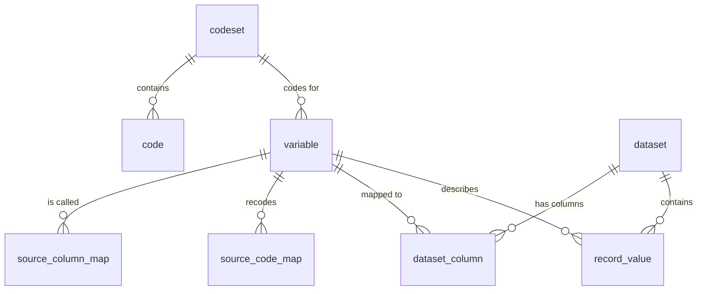

# Housing metadata demo

A small example of one **generalised** metadata model for annual housing data.
It joins records, variable descriptions and codesets the same way for every
province.

**The main idea:** there is no province-specific code. A province is
different only in its rows in two mapping tables. To add a province, a
renamed column or a new code, you edit a CSV, not a pipeline.

## Quick start (uv)

```bash
uv sync
uv run housing-sample              # fake Parquet for ON, BC, NS for 2024 and 2025
uv run housing-build               # builds housing_meta.duckdb and prints QA
uv run housing-build --year 2025   # annual run: reloads only 2025
uv run housing-build --export output   # also writes every table to Parquet (for Fabric/Delta)
duckdb housing_meta.duckdb < sql/03_demo_queries.sql
```

## The model: 8 tables



| Group | Table | Grain | Purpose |
|---|---|---|---|
| Reference | `codeset` | codeset | Named list of codes (TENURE, YES_NO, …) |
| Reference | `code` | codeset × code × validity | Canonical code + label, valid for a range of years |
| Reference | `variable` | variable | Canonical variable: label, type, unit, codeset, valid years, role (`key`/`attribute`) |
| Mapping | `source_column_map` | province × column × validity | Province column name → canonical variable |
| Mapping | `source_code_map` | province × variable × value × validity | Province code → canonical code. If a province has no rows for a variable, its values pass through as-is |
| Production | `dataset` | one row per input file | Province, reference year, path, record count |
| Production | `dataset_column` | file × column | Every column found in the file, and what it mapped to (lineage) |
| Production | `record_value` | record × variable | Long-form harmonised values: `source_value` (as delivered) and `value` (canonical) |

The reference and mapping tables are small, kept in source control as CSVs
in `metadata/`, and reloaded on every build. The production tables are
replaced one province-year at a time, so an annual run doesn't touch earlier
years.

All validity uses `reference_year BETWEEN valid_from_year AND coalesce(valid_to_year, 9999)`.
That one rule handles renamed columns (ON `shelter_cost_mth` → `monthly_shelter_cost`
in 2025), variables added later (`PERIOD_BUILT` from 2025) and retired codes.

## Views (what analysts actually use)

| View | What it gives you |
|---|---|
| `v_record_labelled` | Every value with its variable label, unit, canonical code and code label. This is the "seamless join" |
| `v_data_dictionary` | Variables + codes valid in each year |
| `household_harmonised` (table) | Wide, typed, one row per record, canonical column names, generated from `variable` |
| `v_qa_summary` | Rolls up the checks below. Should be all zeros |
| `v_qa_unmapped_columns` | Province sent a column nobody mapped |
| `v_qa_missing_variables` | A variable expected that year is missing from a file |
| `v_qa_unmapped_values` | Province sent a code with no entry in `source_code_map` |
| `v_qa_invalid_codes` | A canonical value that isn't in the codeset for that year |
| `v_qa_bad_numerics` | A numeric variable whose values don't cast |

The sample data has two planted problems so the QA has something to show:
BC sends an extra `REGION_INTERNAL` column, and BC 2025 has a new tenure code `3`.

## How the load works (`src/housing_meta/build.py`)

For each `data/raw/year=YYYY/province=XX/*.parquet`:

1. Register the file in `dataset`.
2. `DESCRIBE` the file and left-join its columns to `source_column_map` for
   that province and year, which gives `dataset_column`.
3. Select the mapped columns, renamed to canonical ids and cast to VARCHAR, then
   `UNPIVOT` to long form.
4. Left-join to `source_code_map` to recode, then insert into `record_value`.

It's the same SQL for every province.

## Typical annual changes and what you edit

| Change | Edit |
|---|---|
| New province | Add rows to `source_column_map` (and `source_code_map` if it uses its own codes) |
| Province renames a column | Close the old row (`valid_to_year`), add a new row |
| New variable this year | Add a row to `variable` (+ `codeset`/`code` if coded) and a mapping per province |
| Province adds a code | Add a row to `source_code_map`. `v_qa_unmapped_values` tells you when you need to |
| Code retired | Set `valid_to_year` on the `code` row |

## Notes for production

- `record_value` keeps values as VARCHAR on purpose, so one table can hold every
  variable. Typing happens in `household_harmonised` and in `value_num`. At
  production volumes, partition the Parquet export by `reference_year` /
  `source_system`, or write it out as Delta with delta-rs.
- Put a non-zero `v_qa_summary` in CI as a failing check, so a new province
  code can't slip through quietly.
- Bilingual labels: add `label_fr` next to `label_en` in `code` and `variable`.
