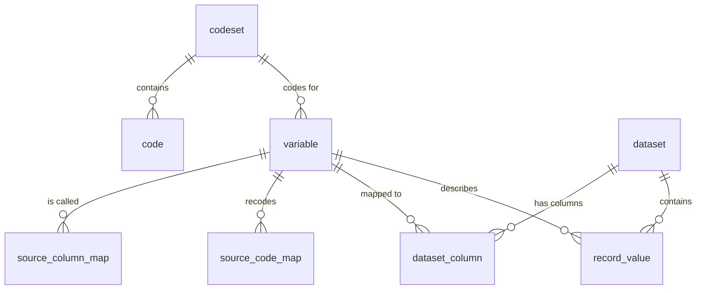

# Housing metadata model

A metadata-driven way to load annual housing data from several provinces into one
consistent, labelled, quality-checked model, **without province-specific code**.

The problem it solves: every province sends the same concepts (tenure, dwelling type,
shelter cost…) under different column names and code values, and those change from
year to year. The usual result is a pipeline full of `if province == ...` and
`if year >= ...` branches, and someone has to rewrite it every year.

This model moves all of that knowledge into **rows of metadata**:

- A province calls tenure `TEN`? That's a row in `source_column_map`.
- It codes owners as `O`? That's a row in `source_code_map`.
- It renamed a column in 2025? Close the old row's `valid_to_year`, add a new row.
- A new province joins? Add its mapping rows. The code stays the same.

The pipeline itself (one Python file and two SQL files) is the same for every province and
every year. It builds with [DuckDB](https://duckdb.org) and exports to Parquet for
Fabric / Delta.

> **Start here:** [`notebooks/walkthrough.ipynb`](notebooks/walkthrough.ipynb) walks through
> the whole idea with charts, ending with a simulated 2026 delivery (a column rename, a new
> code and a new province) handled only with CSV edits.

---

## Contents

- [Quick start](#quick-start)
- [Repository layout](#repository-layout)
- [Core concepts](#core-concepts)
- [The model: 8 tables](#the-model-8-tables)
- [How a load works](#how-a-load-works)
- [Views: what analysts use](#views-what-analysts-use)
- [QA checks](#qa-checks)
- [Annual maintenance playbook](#annual-maintenance-playbook)
- [Querying the output](#querying-the-output)
- [Known limitations and next steps](#known-limitations-and-next-steps)
- [Notes for production](#notes-for-production)

---

## Quick start

Requires [uv](https://docs.astral.sh/uv/) and Python 3.10+.

```bash
uv sync
uv run housing-sample                  # fake Parquet for ON, BC, NS for 2024 and 2025
uv run housing-build                   # builds housing_meta.duckdb and prints QA
uv run housing-build --year 2025       # annual run: reloads only 2025
uv run housing-build --export output   # also writes every table to Parquet
duckdb housing_meta.duckdb < sql/03_demo_queries.sql
```

Example build output:

```
Reference metadata
  meta.codeset                4 rows
  meta.code                  12 rows
  meta.variable               8 rows
  meta.source_column_map     25 rows
  meta.source_code_map       21 rows
Datasets
  BC_2024     200 records   6 variables     1200 values
  ...
QA summary
  !!  unmapped_columns   2
  OK  missing_variables  0
  !!  unmapped_values    1
  OK  invalid_codes      0
  OK  bad_numerics       0
```

The two `!!` lines are expected: the sample data contains two planted problems so the
QA has something to catch (see [QA checks](#qa-checks)).

### Walkthrough notebook

```bash
uv sync --group demo
uv run jupyter lab notebooks/walkthrough.ipynb
```

The notebook is saved with its outputs, so you can read it on GitHub or in VS Code without
running it. When you do run it, it uses a temporary copy of `metadata/` and `data/raw/`
and an in-memory database, so it never changes the repo.

| Section | Shows |
|---|---|
| 1. The problem | Raw schemas and raw codes per province |
| 2. The metadata | The CSVs that hold every province-specific fact |
| 3. Build | The generic load |
| 4. Lineage | A source-column map per variable × province × year, with renames highlighted |
| 5. Harmonised output | Province codes become canonical, labelled values |
| 6. Analysis | Cross-province charts with zero province logic |
| 7. QA | Which check fires and what to edit |
| 8. Annual cycle | 2026: rename + new code + new province, fixed with CSV rows only; the partial-reload gotcha |

---

## Repository layout

```
metadata/                 Reference + mapping tables (the only thing you edit year to year)
  codeset.csv             Named code lists
  code.csv                Canonical codes + labels, with validity
  variable.csv            Canonical variables: name, label, type, unit, codeset, role
  source_column_map.csv   Province column  -> canonical variable, with validity
  source_code_map.csv     Province value   -> canonical code, with validity
data/raw/year=YYYY/province=XX/*.parquet   Input files (Hive-style layout)
sql/
  01_schema.sql           Table definitions
  02_views.sql            Labelled views, data dictionary, QA views
  03_demo_queries.sql     Example queries
src/housing_meta/
  build.py                The generic pipeline (housing-build)
  generate_sample.py      Fake province data (housing-sample)
notebooks/
  walkthrough.ipynb       Narrative demo with charts
```

---

## Core concepts

**1. Canonical vs source.** A *canonical variable* (`TENURE`) is what we mean. A
*source column* (`tenure_cd`, `TEN`, `tenure`) is what a province calls it. The mapping
tables connect the two. Everything downstream uses only canonical names.

**2. Everything has a validity range.** Every reference and mapping row has
`valid_from_year` and `valid_to_year` (blank means still valid). One rule applies
everywhere:

```sql
reference_year BETWEEN valid_from_year AND coalesce(valid_to_year, 9999)
```

That one rule covers renamed columns (ON `shelter_cost_mth` → `monthly_shelter_cost` in
2025), variables added later (`PERIOD_BUILT` from 2025) and retired codes. You never
write a year check in code.

**3. Recode or pass through.** If a province has any `source_code_map` rows for a
variable in a year, its values are recoded through the map, and any value without a map
row is flagged. If it has none (NS already uses canonical codes, and numeric
variables never need a map), values pass through unchanged. `record_value.mapped_via`
records which path each value took.

**4. Long form underneath, wide form on top.** All values are stored in one long
table (`record_value`: one row per record × variable), so a new variable never needs
a schema change. A wide, typed table (`household_harmonised`) is *generated* from
`variable` for analysts who want ordinary columns.

**5. Keep the source value.** `record_value` keeps both `source_value` (as
delivered) and `value` (canonical), so every recode can be audited.

**6. QA is part of the model.** Because the load is generic, the checks are too.
Each QA view maps to a specific metadata fix.

---

## The model: 8 tables



| Group | Table | Grain | Purpose |
|---|---|---|---|
| Reference | `codeset` | codeset | Named list of codes (TENURE, YES_NO, …) |
| Reference | `code` | codeset × code × validity | Canonical code + label, valid for a range of years |
| Reference | `variable` | variable | Canonical variable: label, type, unit, codeset, valid years, role (`key`/`attribute`) |
| Mapping | `source_column_map` | province × column × validity | Province column name → canonical variable |
| Mapping | `source_code_map` | province × variable × value × validity | Province code → canonical code. If a province has no rows for a variable, its values pass through as-is |
| Production | `dataset` | one row per input file | Province, reference year, path, record count, load time |
| Production | `dataset_column` | file × column | Every column found in the file, and what it mapped to (lineage) |
| Production | `record_value` | record × variable | Long-form harmonised values: `source_value` (as delivered), `value` (canonical), `mapped_via` |

| Group | Lives in | Maintained by | Rebuilt |
|---|---|---|---|
| Reference | `metadata/*.csv` in git | Subject-matter owners | Every build |
| Mapping | `metadata/*.csv` in git | Data team | Every build |
| Production | DuckDB / Parquet | The pipeline | One province-year at a time |

Each variable has a `role`: exactly one `key` (the record identifier, `HH_ID`) and any
number of `attribute`s.

---

## How a load works

`housing-build` (see [`src/housing_meta/build.py`](src/housing_meta/build.py)):

1. Recreate the reference and mapping tables from `metadata/*.csv`. Codes are read as
   text, so `01` stays `01`.
2. Find every `data/raw/year=YYYY/province=XX/*.parquet` (filtered by `--year` if given).
3. For each file:
   1. Delete any earlier load of that province-year and register the file in `dataset`.
   2. `DESCRIBE` the file and left-join its columns to `source_column_map` for that
      province and year. This gives `dataset_column`, including unmapped columns.
   3. Select the mapped columns, renamed to canonical ids and cast to `VARCHAR`, then
      `UNPIVOT` to long form.
   4. Left-join to `source_code_map` to recode, and insert into `record_value`.
4. Create the views, regenerate `household_harmonised` and print the QA summary.
5. Optionally `--export DIR` writes every table to Parquet.

It's the same SQL for every province. If a file has no mapped key column (usually a
new province with no mappings yet), its columns are still recorded so the QA can report
them, but its values are skipped. The rest of the build carries on.

From Python, `housing_meta.build.build(con, meta_dir, raw_dir, years=None)` runs the
same pipeline against any DuckDB connection, including an in-memory one (the notebook
uses this).

---

## Views: what analysts use

| View / table | What it gives you |
|---|---|
| `v_record_labelled` | Every value with its variable label, unit, canonical code, code label and numeric value. This is the "seamless join" |
| `v_data_dictionary` | Variables + codes valid in each loaded year |
| `household_harmonised` (table) | Wide, typed, one row per record, canonical column names, generated from `variable` |
| `v_qa_*` | See below |

---

## QA checks

Every QA view should return zero rows on a clean build. `v_qa_summary` rolls them up.

| View | Fires when | Usual fix |
|---|---|---|
| `v_qa_unmapped_columns` | A province sent a column nobody mapped | Add a `source_column_map` row |
| `v_qa_missing_variables` | A variable valid that year is missing from a file | Usually a rename: close the old mapping row, add the new one |
| `v_qa_unmapped_values` | A province sent a code with no `source_code_map` row | Add a `source_code_map` row (and a `code` row if it is a new concept) |
| `v_qa_invalid_codes` | A canonical value isn't in the codeset for that year | Fix the map's target code, or extend the `code` validity |
| `v_qa_bad_numerics` | A numeric variable has values that don't cast | Raise with the province |

The checks work together. An unmapped column *plus* a missing variable in the same file
is almost always a rename.

The sample data plants two problems: BC sends an extra `REGION_INTERNAL` column, and BC
2025 has a tenure code `3` that has no mapping.

---

## Annual maintenance playbook

1. Drop the new files into `data/raw/year=YYYY/province=XX/`.
2. Run `uv run housing-build --year YYYY`.
3. Read the QA summary. For anything non-zero, query the matching `v_qa_*` view.
4. Edit `metadata/*.csv` (see the table below) and open a PR for review.
5. Re-run. Repeat until the QA is clean.
6. **If any edited row has `valid_from_year` before YYYY, reload those years too**
   (`--year 2025 2026`), or do a full rebuild. See
   [Known limitations](#known-limitations-and-next-steps).

| Change | Edit |
|---|---|
| New province | Add rows to `source_column_map` (and `source_code_map` if it uses its own codes) |
| Province renames a column | Set `valid_to_year` on the old row, add a new row |
| New variable this year | Add a row to `variable` (+ `codeset`/`code` if coded) and a mapping per province |
| Province adds a code | Add a `source_code_map` row. `v_qa_unmapped_values` tells you when |
| New canonical code | Add a `code` row with `valid_from_year` |
| Code retired | Set `valid_to_year` on the `code` row |
| Variable retired | Set `valid_to_year` on the `variable` row |

In the notebook's 2026 scenario (an ON column rename, a BC code needing a new canonical
code, and a whole new province, Manitoba, with its own names and codes), the full fix is
**24 CSV rows and zero lines of Python**.

---

## Querying the output

Cross-province, labelled, no province logic:

```sql
SELECT reference_year, source_system, value_label AS tenure, count(*) AS households
FROM meta.v_record_labelled
WHERE variable_id = 'TENURE'
GROUP BY ALL ORDER BY ALL;
```

Wide table joined to code labels:

```sql
SELECT h.reference_year, h.source_system, c.label_en AS dwelling_type,
       count(*) AS households, round(avg(h.monthly_shelter_cost)) AS avg_cost
FROM meta.household_harmonised h
LEFT JOIN meta.code c ON c.codeset_id = 'DWELL_TYPE' AND c.code = h.dwelling_type
GROUP BY ALL ORDER BY ALL;
```

One record, fully traced from source value to label:

```sql
SELECT variable_label, source_value, value, value_label, unit
FROM meta.v_record_labelled
WHERE dataset_id = 'ON_2025' AND record_id = 'ON202500000';
```

More in [`sql/03_demo_queries.sql`](sql/03_demo_queries.sql).

---

## Known limitations and next steps

These came up in review and are worth settling before production use:

| # | Limitation | Effect | Suggested fix |
|---|---|---|---|
| 1 | **No way to ignore a column on purpose.** Every unmapped column is a QA failure. | `REGION_INTERNAL` stays red for good, and the QA stops meaning anything if people learn to ignore it. | Allow `source_column_map` rows with an empty `variable_id` (or an `action = 'ignore'` column) meaning "known, excluded", and have `v_qa_unmapped_columns` flag only columns with no row at all. |
| 2 | **Recoded values are stored, not derived.** `record_value.value` is fixed at load time. | A mapping fix that reaches back to earlier years doesn't apply until those years are reloaded (the notebook shows this). | Short term: reload every affected year (playbook step 6). Longer term: store only `source_value` and recode in a view, or have the build detect metadata changes and reload affected years. |
| 3 | **One dataset per province-year.** `dataset_id = {province}_{year}`. | If a province delivers several Parquet files in one partition, each one overwrites the last and only the final file is kept. | Include the file name in `dataset_id`, or read the partition as one glob. |
| 4 | **`NULL`s are dropped** by `UNPIVOT`. | You can't tell "delivered as null" from "not delivered" in `record_value`. | Use `UNPIVOT INCLUDE NULLS` if that difference matters. |
| 5 | **No orphan check on mapping targets.** A `source_code_map.code` that isn't in `code` is only caught once data uses it. | Typos stay hidden until the code turns up in the data. | Add a static metadata QA view (map targets ⊆ codes valid in the same years). |
| 6 | **One grain.** One `key` variable per file; the wide table is named `household_harmonised`. | Person-level or dwelling-level files would need a second key and wide table. | Add an `entity` column to `variable` and generate one wide table per entity. |
| 7 | **No automated tests or CI.** | Nothing fails if QA goes red. | Add a pytest that builds the sample and asserts the QA counts, and fail CI on a non-zero `v_qa_summary`. |
| 8 | **Build output is committed.** `housing_meta.duckdb` (~6 MB) is tracked in git. | Noisy diffs and merge conflicts. | Add `*.duckdb` to `.gitignore` and `git rm --cached` it. |

---

## Notes for production

- `record_value` keeps values as `VARCHAR` on purpose, so one table can hold every
  variable. Typing happens in `household_harmonised` and `value_num`. At production
  volumes, partition the Parquet export by `reference_year` / `source_system`, or write
  Delta with delta-rs.
- Put a non-zero `v_qa_summary` in CI as a failing check, so a new province code can't
  slip through quietly.
- Bilingual labels: add `label_fr` next to `label_en` in `code` and `variable`.
- The model isn't specific to housing. Swap the CSVs and the sample generator and the
  same pipeline handles any "many sources, one canonical schema, annual drift" problem.
