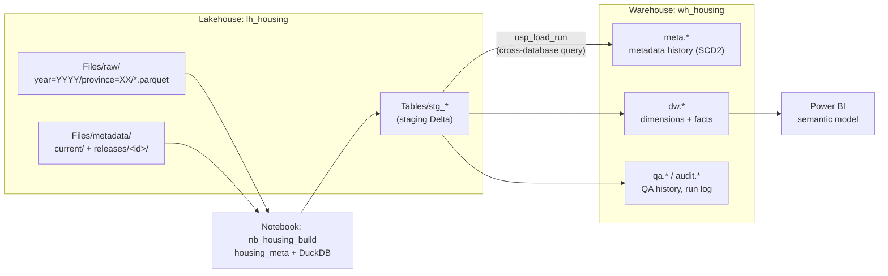
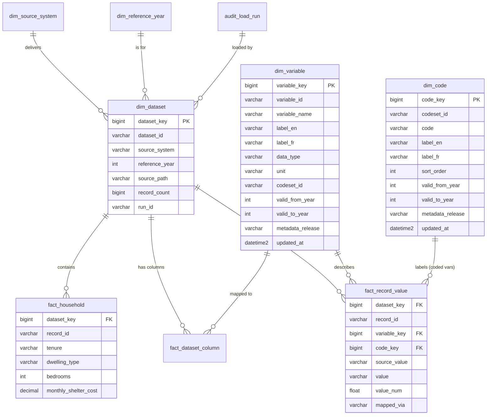

# Fabric deployment design: housing metadata model

**Status:** Draft for team review · **Date:** 2026-11-09 · **Implementation:** [`fabric/`](../fabric/README.md) (first version, not yet tested in a Fabric workspace)

This document proposes how to run the housing metadata model in Microsoft Fabric, with the
final output stored in a Fabric Data Warehouse. It's a design to discuss, not a final
decision. [Open questions](#11-open-questions) lists the points still to settle.

---

## 1. Summary

These choices have been made:

| Decision | Choice |
|---|---|
| Where the harmonisation runs | The existing DuckDB build, run in a **Fabric Python notebook** |
| Final store | A **Fabric Data Warehouse** with a **star schema** |
| Where metadata is maintained | **Files in a Lakehouse** (`Files/metadata/`), released as dated snapshots |
| Orchestration | A **Fabric Data Pipeline** (notebook → stored procedure), **one run per province-year** |
| Trigger | The team's scheduling tool calls the pipeline with four parameters when a delivery lands |

In one paragraph: province files and metadata files land in a Lakehouse. A notebook runs
the same `housing_meta` build we run locally and writes its output as **staging Delta
tables** in that Lakehouse. A stored procedure in the Warehouse reads the staging tables,
keeps a **versioned history of the metadata**, loads **dimensions and facts**, records
**QA results and an audit trail**, and publishes only if the blocking QA checks pass.
Analysts and Power BI read the Warehouse.

Why this split: the mapping logic stays in one place (`housing_meta`). The code we test
locally is the code that runs in Fabric. The Warehouse does what it's good at: a governed,
historised, query-ready model.

---

## 2. Goals and non-goals

**Goals**

- One annual process for every province, driven by metadata, the same as the demo.
- A mature warehouse: conformed dimensions, a history of metadata changes, load audit, QA history.
- Every published number traceable to a delivered file, a metadata release and a pipeline run.
- Metadata maintainable by the team without code changes, with a review step before production.
- Separate dev, test and prod environments.

**Non-goals (for now)**

- Real-time or event-driven loading. Deliveries are annual; runs are triggered by hand.
- Replacing the local DuckDB workflow. It stays the way to develop and test mappings.
- Moving the harmonisation logic into T-SQL or Spark.

---

## 3. Architecture



The pipeline `pl_housing_load` is kept deliberately small. It has two activities and is
driven entirely by four parameters that the calling tool sets:

| Parameter | Example | Meaning |
|---|---|---|
| `source_system` | `ON` | Province; matches `province=XX` in `Files/raw` |
| `reference_year` | `2025` | Matches `year=YYYY` in `Files/raw` |
| `metadata_release` | `current` | `current` or a folder under `Files/metadata/releases/` |
| `mode` | `validate` | `validate` runs QA only; `publish` runs QA, then loads the Warehouse |

1. **Notebook** `nb_housing_build` (gets the four parameters, plus `run_id = @pipeline().RunId`).
   It builds that one province-year, appends it to the staging tables, and refreshes the
   Lakehouse SQL endpoint so the Warehouse sees it (see [§9](#9-fabric-constraints-and-how-the-design-handles-them)).
2. **Stored procedure** `audit.usp_load_run` (same parameters): QA gate, metadata history,
   dimensions and facts. Blocking QA issues make it fail, so the **pipeline run shows as
   Failed** with the reason, and the calling tool sees it without any extra activities.

The pipeline has `concurrency = 1`, so deliveries that arrive together queue instead of
racing. The calling tool starts a run with one REST call
(`POST .../items/{pipelineId}/jobs/instances?jobType=Pipeline`), and `housing-fabric run`
does the same from the command line. The pipeline definition, notebook and Warehouse
scripts are generated together by `housing-fabric bundle`, so their parameter names can't
drift apart.

### Fabric items

| Item | Name (suggested) | Purpose |
|---|---|---|
| Lakehouse | `lh_housing` | Landing zone for raw files and metadata, plus staging tables |
| Notebook (Python) | `nb_housing_build` | Runs `housing_meta.build` and writes staging Delta tables |
| Warehouse | `wh_housing` | Final star schema, metadata history, QA and audit |
| Data Pipeline | `pl_housing_load` | Orchestration and QA gate |
| Semantic model | `sm_housing` | Power BI model over the `dw` schema |

---

## 4. Storage layout in OneLake

```
lh_housing
├── Files
│   ├── raw/year=YYYY/province=XX/*.parquet     Province deliveries, never edited after landing
│   └── metadata
│       ├── current/                            Working copy the team edits (5 CSV/Excel files)
│       └── releases/2026-11-15_r1/             Approved, read-only snapshots; production reads these
└── Tables                                    Staging, partitioned by run_id
    ├── stg_dataset, stg_dataset_column, stg_record_value
    ├── stg_codeset, stg_code, stg_variable     Reference metadata, for dimensions
    ├── stg_metadata                            All five metadata tables, one row per metadata row
    └── stg_qa_summary, stg_qa_detail           QA results and which checks block
```

- **Each run appends to its own `run_id` partition** of the staging tables, so runs
  never overwrite each other. Partitions older than 30 days are pruned by the notebook.
  Staging is a hand-off area, not a store of record; the Warehouse is the store of record.
- **Raw deliveries are immutable.** A corrected delivery is a new file, and the old one
  is kept.

---

## 5. Metadata maintenance workflow

This replaces "edit CSVs in git" from the demo.

1. **Edit** the files in `Files/metadata/current/`, for example through OneLake file
   explorer or by uploading in the portal.
2. **Validate** by running the pipeline in the **dev** workspace against `current`. It
   produces the QA results and lineage without publishing anything.
3. **Review**: a second person checks the QA output and the row-level diff against the
   last release. The pipeline can produce the diff (see below).
4. **Release**: copy `current/` to `releases/<date>_<n>/`. Releases are never edited.
5. **Publish**: run the **prod** pipeline with `metadata_release = <date>_<n>`.

The Warehouse keeps every release it has loaded (`meta.*` tables, SCD type 2). That lets
us answer "which mapping was in effect when this number was published?"

**This also tackles the demo's partial-reload problem.** When a publish brings in
metadata rows that changed, the procedure looks up every *already-published*
province-year those rows apply to (same province, or any province for reference
tables, within the rows' validity years). It records each one as a
**`reload_recommended`** warning in `qa.check_detail`. Re-publishing those province-years
is one pipeline call each. The procedure flags rather than reloads, because one pipeline
run handles exactly one province-year.

---

## 6. Warehouse model

### Schemas

| Schema | Contents | Who reads it |
|---|---|---|
| `meta` | Versioned copies of the five metadata tables (SCD2) and the release log | Data team |
| `dw` | Dimensions, facts and analyst views | Analysts, Power BI |
| `qa` | QA results for every run | Data team, release reviewers |
| `audit` | Pipeline runs, row counts, versions | Data team |

### Star schema (proposed)



| Table | Grain | Notes |
|---|---|---|
| `dim_source_system` | province / source | Name, region, first and last year delivered |
| `dim_reference_year` | year | Small and static; useful for Power BI |
| `dim_variable` | variable | Type 1: current definition; `valid_from_year` / `valid_to_year` keep their *business* meaning |
| `dim_code` | codeset × code × valid_from_year | Type 1, same as `dim_variable` |
| `meta.metadata_history` | metadata row × version | SCD2 history of **all five** metadata tables in one table: natural key, full row as JSON, release, effective from/to. This is where *version* history lives |
| `dim_dataset` | delivered file | One row per province-year file, with the run that loaded it |
| `fact_record_value` | record × variable | The long table from the demo, with surrogate keys. The single source for any variable |
| `fact_household` | record | Wide and typed, generated from `dim_variable` (see below) |
| `fact_dataset_column` | file × source column | Lineage, including unmapped columns |
| `qa.check_result` | run × check × detail row | Each run's QA output, so trends and regressions are visible |
| `audit.load_run` | pipeline run | Start/end, status, metadata release, years loaded, code version, row counts |

**Two kinds of time.** Keeping these apart is the most important modelling point:

- *Reference-year validity* (`valid_from_year` / `valid_to_year`): is this code valid for
  2025 data? This is part of the meaning, and it's what the demo already uses.
- *Version history* (`meta.metadata_history`): what did we believe this code meant as of
  a given release? This is new in the Warehouse and gives us auditability. Keeping it in
  one generic table, not in each dimension, means a new metadata table or column needs no
  Warehouse change.

**Keys.** Surrogate `bigint` keys on dimensions, using `IDENTITY` (supported in Fabric
Warehouse). Natural keys (`variable_id`, `codeset_id` + `code`, `dataset_id`) stay on
every row. Primary and foreign keys are declared `NOT ENFORCED`. Fabric doesn't enforce
them, but they document the model and help the optimiser and Power BI. Integrity is
checked by the procedure's QA step instead.

**The wide table (`fact_household`)** gets a new column whenever a variable is added.
Fabric's `ALTER TABLE` can add nullable columns, so the procedure either adds the missing
columns or rebuilds the table with `CREATE TABLE AS SELECT` and swaps it in. Recommended:
rebuild and swap. It's simpler and the table is small.

### Analyst views (`dw` schema)

These carry the demo's views over to the Warehouse, so the queries in the walkthrough
notebook port almost unchanged:

- `dw.v_record_labelled`: each value with its variable label, unit and code label (current release).
- `dw.v_data_dictionary`: variables and codes valid in each reference year.
- `dw.v_lineage`: source column → variable, by province and year.

---

## 7. Load procedure (`audit.usp_load_run`)

One procedure, run once per pipeline run, in this order:

1. **Start the run**: check the staged rows are visible, then insert into
   `audit.load_run` (status `running`).
2. **QA gate**: copy the staged QA into `qa.check_summary` / `qa.check_detail`. If any
   **blocking** check is non-zero, mark the run `failed_qa` and `THROW`, so the pipeline
   run fails with the reason. In `validate` mode, stop here either way (status `validated`).
3. **Version the metadata**: close changed or removed rows in `meta.metadata_history`
   and insert the new versions. Flag `reload_recommended` province-years ([§5](#5-metadata-maintenance-workflow)).
4. **Dimensions**: upsert `dim_variable`, `dim_code`, `dim_source_system` and `dim_dataset`.
5. **Facts**: `DELETE` then `INSERT` this province-year's `fact_record_value` and
   `fact_dataset_column` inside one transaction. Reruns are safe.
6. **Wide table**: regenerate `fact_household` from `dim_variable` (dynamic CTAS).
7. **Close the run**: row count and status `published`.

**Which checks block publishing (proposed):**

| Check | Blocks? | Why |
|---|---|---|
| `unmapped_values` | Yes | A code with no mapping would publish as NULL |
| `invalid_codes` | Yes | A value outside the codeset is a wrong answer |
| `bad_numerics` | Yes | Values would silently become NULL in typed columns |
| `missing_variables` | Yes | Usually an unhandled rename |
| `unmapped_columns` | Warn only | Until the model supports deliberately ignoring a column (README, limitation 1) |

---

## 8. Changes needed in this repo

| Change | Why | Status |
|---|---|---|
| Move the build SQL inside the package (`importlib.resources`) | `build.py` found it from the repo root, which doesn't exist once installed as a wheel in Fabric | Done |
| Province and year filters on the build (`--province`, `provinces=`) | One pipeline run = one province-year | Done |
| `staging.export_staging()` / `prune_staging()` | Staging Delta tables partitioned by `run_id`, with old runs pruned | Done |
| `fabric_run.run_delivery()` | Everything the notebook does, testable locally | Done |
| `housing-fabric bundle / deploy-pipeline / run` | Generates the pipeline definition, notebook and Warehouse SQL; creates the pipeline; calls it | Done |
| pytest on the sample data | Build, staging and QA, plus parameter consistency across pipeline, notebook and procedure | Done (`uv run pytest`) |
| `diff_releases(old_dir, new_dir)` | Row-level metadata diff for reviewers | Open |
| Fix README limitation 3 (one dataset per province-year) | Real deliveries may arrive as several files | Open |
| Add the "ignore column" mapping (README limitation 1) | Lets `unmapped_columns` become a blocking check | Open |

The notebook itself stays small. It installs the `housing_meta` wheel (kept in
`lh_housing/Files/lib/`), reads `Files/raw` and `Files/metadata/releases/<id>` through
the default Lakehouse mount (`/lakehouse/default/Files/...`), calls `build.build()` on an
in-memory DuckDB connection, and calls `export_staging()`.

---

## 9. Fabric constraints and how the design handles them

These are from Microsoft's current documentation (see [Sources](#sources)). Recheck them
before building, because Fabric changes quickly.

| Constraint | Effect | Handling |
|---|---|---|
| Primary, foreign and unique keys must be `NOT ENFORCED` | Duplicates and orphans aren't blocked by the engine | QA checks in the procedure; keys declared for documentation and the optimiser |
| No `nvarchar` / `nchar` | Unicode needs UTF-8 `varchar` | Use `varchar`; French labels (`label_fr`) work in UTF-8 |
| Lakehouse string columns use a binary, case-sensitive collation (`Latin1_General_100_BIN2_UTF8`) | `'apt'` ≠ `'APT'` when comparing staging values | Codes are already compared exactly in DuckDB; no change, but worth knowing when querying staging |
| `ALTER TABLE` can only add nullable columns, drop columns, and add or drop `NOT ENFORCED` constraints (`ALTER COLUMN` is in preview) | Changing types or widening the wide table is limited | Rebuild `fact_household` with CTAS and swap |
| Lakehouse SQL endpoint metadata sync can lag behind writes | The Warehouse may read stale staging data | After the notebook, force a refresh: the *Refresh SQL endpoint metadata* REST API, or `sys.sp_dw_refresh_ext_table` if the workspace uses the new metadata sync (preview). Check `stg_*` row counts against the notebook's before loading |
| Delta written by Python libraries in the wrong folder shows up as "Unidentified" | The staging table isn't visible to SQL | Write directly under `Tables/` (or `Tables/dbo/` in a schema-enabled Lakehouse), with no nested subfolders |
| `datetime2` / `time` are limited to 6 fractional digits | None for this data | Use `datetime2(6)` for timestamps |
| No triggers or materialised views | No automatic follow-on logic | Everything runs in the procedure and the pipeline |
| `MERGE` is generally available; `IDENTITY` and `TRUNCATE` are supported | We can use them | Used for SCD2 and surrogate keys |

---

## 10. Environments, deployment and security

- **Workspaces:** `housing-dev`, `housing-test` and `housing-prod`, promoted with Fabric
  **deployment pipelines**.
- **Source control:** connect the dev workspace to this repo through Fabric **git
  integration**, so the notebook, pipeline and Warehouse definitions are versioned.
  Microsoft notes limitations when adding table constraints or columns to a Warehouse
  under git integration. Keep schema changes in explicit migration scripts in `fabric/`.
- **Metadata releases** promote as data: the same `releases/<id>` folder is copied to
  test and then prod.
- **Access:**
  - Analysts get read access to `dw` views only.
  - The data team owns `meta`, `qa`, `audit` and the Lakehouse.
  - Raw deliveries are restricted to the pipeline identity and the data team.
  - Add row-level security by province only if there's a need for it.
- **Power BI:** a semantic model over the `dw` star schema. `fact_record_value` gives
  generic, any-variable reporting, and `fact_household` gives typed, analyst-friendly columns.

---

## 11. Open questions

1. **Metadata file format.** CSV (matches the demo, diffs cleanly) or Excel (friendlier to
   edit)? The build can read either, but CSV keeps reviews simpler.
2. **Who approves a metadata release?** A named owner per group (reference vs mapping), or one data lead?
3. **Blocking QA checks.** Is the proposed list in [§7](#7-load-procedure-auditusp_load_run) right? Should `unmapped_columns` block once the ignore option exists?
4. **History depth.** Keep every metadata version forever, or only the releases used for a publication?
5. **Republishing.** When a reload changes already-published numbers, do we need to keep the old fact rows (a snapshot per publication), or is the metadata history enough?
6. **Scale.** Real record counts per province-year. The long fact table is records × variables, which decides whether Python notebook memory is enough or whether larger years need chunking.
7. **Model changes.** Which changes from the deck's "open for discussion" list (ignore option, recode when queried, more than one record type) should go in before the first Fabric build?

---

## 12. Proposed phases

| Phase | Scope | Done when |
|---|---|---|
| 1. Proof of concept | Dev workspace, sample data, notebook → staging → Warehouse, manual run | The walkthrough notebook's queries return the same results from `wh_housing` |
| 2. Real data, parallel run | One real year, real metadata release, alongside the current process | Outputs reconcile with the current process, and differences are explained |
| 3. Production | Test/prod workspaces, deployment pipelines, QA gate, Power BI model, runbook | The annual run is done by following the runbook, with no code changes |

---

## Sources

- [T-SQL surface area in Fabric Data Warehouse](https://learn.microsoft.com/en-us/fabric/data-warehouse/tsql-surface-area): MERGE (GA), IDENTITY, TRUNCATE, ALTER TABLE limits, `NOT ENFORCED` constraints, unsupported features
- [Data types in Fabric Data Warehouse](https://learn.microsoft.com/en-us/fabric/data-warehouse/data-types): no `nvarchar`, `datetime2(6)`, Delta-to-SQL type mapping and collation
- [SQL analytics endpoint metadata sync](https://learn.microsoft.com/fabric/data-engineering/sql-analytics-endpoint-metadata-sync): sync behaviour, refresh API, `sys.sp_dw_refresh_ext_table`, new metadata sync (preview)
- [Known issue: delayed data availability in the SQL analytics endpoint](https://learn.microsoft.com/en-us/fabric/known-issues/known-issue-1092-delayed-data-availability-analytics-endpoint-pipeline)
- [Fabric community: Python notebook Delta writes showing as "Unidentified"](https://community.fabric.microsoft.com/t5/Data-Engineering/write-deltalake-with-Python-Notebook-is-creating-an-quot/m-p/4403743): community report, not official guidance
